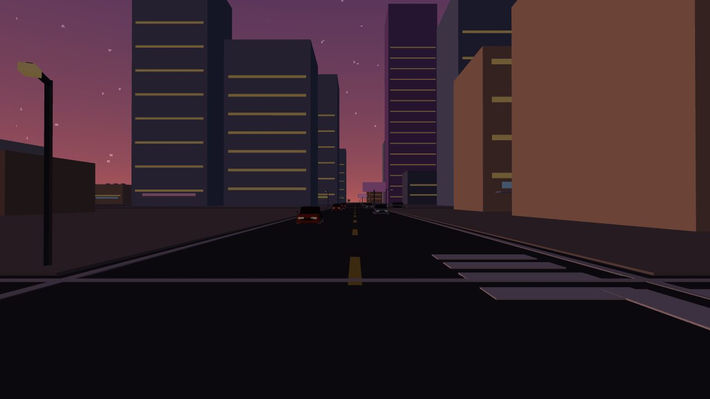
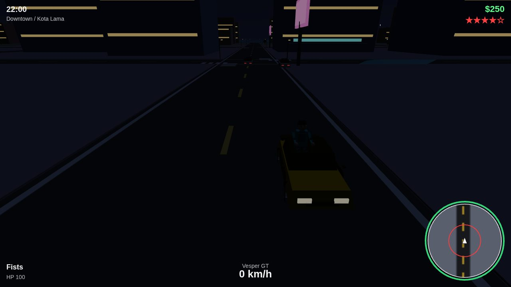
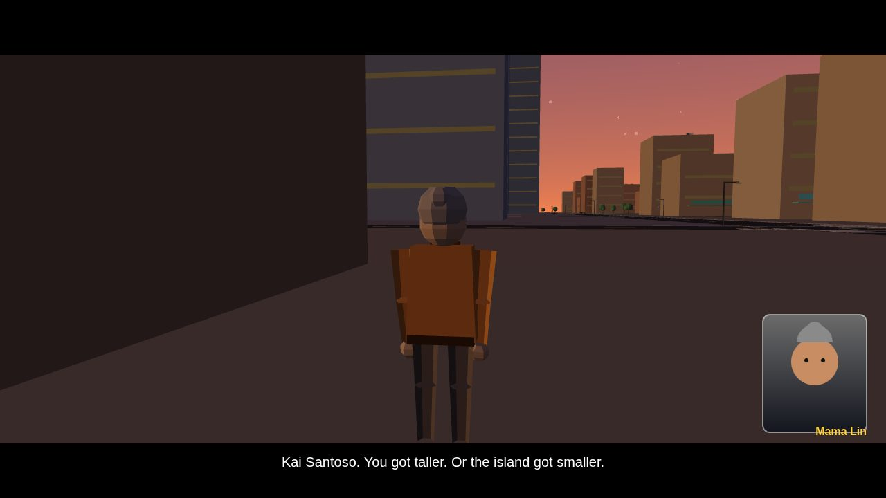
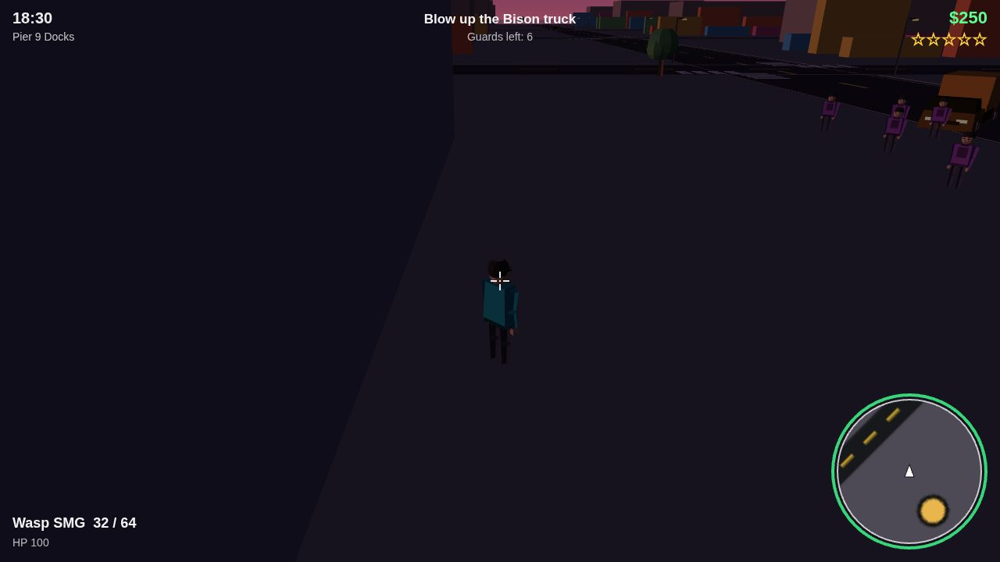

# SELARA BAY

[](https://make.fun/bounty/gta6-01)
[](https://make.fun/bounty/gta6-01)
[](https://make.fun/bounty/gta6-01)

**SELARA BAY** — *"Heat on the Coast"* — is an original 3D open-world crime
game built for the [make.fun gta6-01 bounty](https://make.fun/bounty/gta6-01).
Kai Santoso returns to the coastal city of Selara Bay after five years away
and finds the Black Orchid syndicate squeezing the coast. Drive, fight, and
outrun the law across six story missions, or just cruise the city: steal cars,
lose the cops, collect Orchid tags, and listen to the radio.

Everything is original: the city, the characters, the cars, the music. The
renderer is a custom WebGL2 engine written from scratch — no Three.js, no
Babylon, no game library. The gameplay simulates on a 2D ground plane and
renders in full 3D.

## How to run

No build step, no network. Serve `game/` and open it in desktop Chrome:

```sh
node serve.ts
# open http://localhost:8080
```

Or open `game/index.html` through any static file server. The game runs
offline from static files.

## Controls

| Key | Action |
| --- | --- |
| W A S D | Move / drive (throttle, steer) |
| Mouse | Orbit camera (pointer lock); aim with right mouse |
| Shift | Sprint |
| Space | Jump / handbrake in a car |
| Left mouse | Punch / shoot |
| 1 / 2 / 3 / 4 | Fists / Kobra 9 / Wasp SMG / Thunder shotgun |
| R | Reload |
| F | Enter or exit a car |
| E | Save at the safehouse |
| M | Big map (click to set a waypoint) |
| Esc / P | Pause |

## Missions

1. **Homecoming** — arrive by ferry, drive to Lin's Garage.
2. **Yellow Fever** — steal Rendy's yellow Vesper GT and deliver it.
3. **Collections** — clear the Orchid enforcers at Kedai Orchid, bring the cash back.
4. **Wheelman** — drive Dex to Bank Samudra, survive the 3-star alarm, bring him home.
5. **Low Tide** — night raid on Orchid Freight: six guards and a weapons truck.
6. **Orchid Falls** — chase Viktor Raza to the east pier and finish him at sunrise.

Plus a wanted system from 0 to 5 stars with police cars and foot cops.
Coming next: 12 Orchid tags to collect, a respray shop, a gun shop, a
police helicopter, and rain.

## Screenshots






## Engine

The engine is a custom WebGL2 renderer in `game/js/engine/`, written from
scratch for this game:

- **Rendering:** instanced batches with frustum culling, a directional sun
  plus hemisphere ambient, per-instance colour, emissive windows and neon,
  and a filmic tone curve. Shadows, a post chain (bloom, auto-exposure,
  ACES), and a forward night-light list arrive in the next pass.
- **World:** the city is generated from a seeded layout — 10×10 blocks across
  five districts — and merged into chunked static meshes with instancing and
  frustum culling. All geometry is procedural; all audio is synthesised with
  Web Audio.
- **Simulation:** gameplay runs on the 2D ground plane (movement, collision,
  traffic on a road graph, police, missions) and is rendered in 3D.
- **Sky:** a time-of-day dome (dawn, day, golden hour, purple dusk, starry
  night) with exponential height fog, capped so the city stays crisp.
- **Water:** animated waves with fresnel, sun glints, and shoreline foam
  around the coast, beach, and pier.

## Soundtrack

All sound effects are synthesised live with Web Audio — see
[MUSIC.md](MUSIC.md) for the soundtrack plan. The full soundtrack (three
radio stations: Selara Nights FM, Ombak Lo-Fi, and Gamelan Wave) arrives
with the music pass.

## License

MIT — see [LICENSE](LICENSE).
